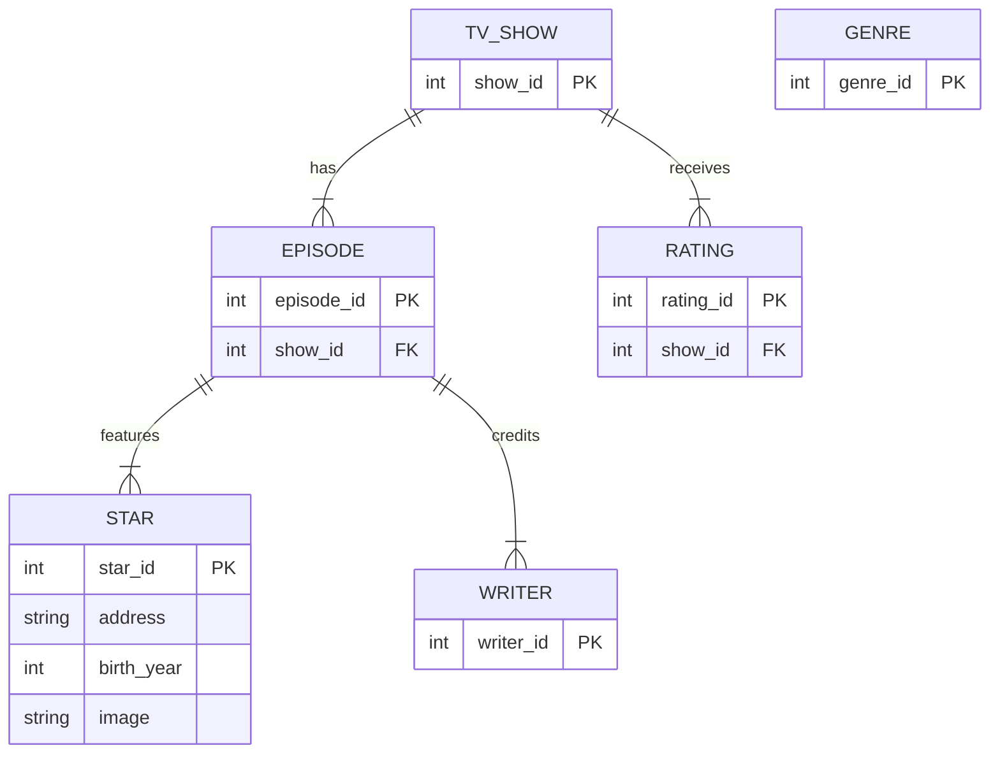

I interpreted the sketch's cardinalities as one TV show having many episodes and ratings, and one episode having many stars and writers. `GENRE` is listed in the sketch but has no relationship drawn. The sketch does not specify keys, so the `*_id` primary keys are placeholders. The Stars attributes are based on the notes for address, birth year, and images.
