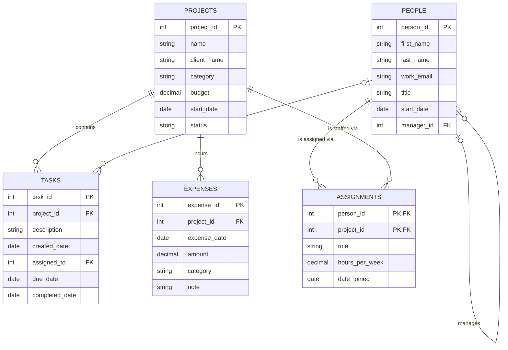

# The Scenario

BabsonAI Labs is a startup founded by Babson students that builds AI tools for small businesses. It has about 25 people and today tracks its work across spreadsheets and chat threads. This database gives the founders one place to see who works on what, where the money goes, and who is overloaded.

What it keeps today:

- **People** — first name, last name, work email, title, start date, and the person they report to. The two founders report to nobody. A person's work email changes whenever their title changes.
- **Projects** — name, client name (internal projects have none), category (LLM app, data pipeline, or internal tool), budget, start date, and status (planned, active, paused, or done).
- **Who works on which project** — a person can work on several projects, and a project has several people. For each pairing: the person's role on that project, the hours a week they commit to it, and the date they joined it.
- **Tasks** — each belongs to one project: a description, the date it was created, the person it's assigned to (a new task may be unassigned), the due date, and the date it was completed, which stays empty until it is.
- **Expenses** — each belongs to one project: the date, the amount, the category (GPU cloud, data labeling, software, or travel), and a short note.

The rules it works by:

- Every person reports to at most one other person, who also works here.
- A budget is more than zero, and so is every expense.
- A task belongs to exactly one project and is assigned to at most one person. It cannot be completed before it was created.
- Nobody commits more than 40 hours a week to a single project, and every commitment is at least one hour.
- A project's status is one of planned, active, paused, or done.
- A task is assigned only to somebody who works on its project, and never before that person's start date.

# The ERD

# What One Row Means

- One row of **people** represents one person who works at BabsonAI Labs.
- One row of **projects** represents one BabsonAI Labs project, whether it is being planned, is running, has paused, or has finished.
- One row of **assignments** represents one person's commitment to one project (their role on it, the hours a week they give it, and the day they joined).
- One row of **tasks** represents one piece of work on one project, assigned to at most one person.
- One row of **expenses** represents one dated expense against one project.

# Design Choices

**The key I chose where the business already had one.** `person_id` is the primary key for people, not `work_email`, even though the business already uses work email as an identifier. Work emails change whenever somebody changes title, so they aren't stable — every task, assignment, and expense tied to that person would become ambiguous the moment their title changed. An invented `person_id` stays constant for as long as the person works here, so `work_email` is kept as a plain attribute instead.

**Which relationships are optional.** `people.manager_id` is optional because the two founders report to nobody, and `tasks.assigned_to` is optional because a new task may be unassigned. Both are nullable foreign keys for exactly that reason.

**The rule my tables can't hold.** A task is assigned only to somebody who works on its project, and never before that person's start date. A `CHECK` only ever sees one row of one table, but this rule has to compare `tasks` against `assignments` and `people` — so it can't be written as a `CHECK`. Business question 7 checks it instead, with a query that joins all three tables and lists any task that breaks it.

**One thing I checked in the design.** I pushed back on the `assignments` table having both `person_id` and `project_id` marked PK and FK at the same time — it looked like a contradiction at first. I understand now that the two columns *together* form the composite primary key of `assignments` (so no person/project pair can be staffed twice), while each column *individually* is also a foreign key back to its own table (`people` or `projects`) — the standard way to model a many-to-many relationship that carries its own facts (role, hours, date joined) on each pairing.
